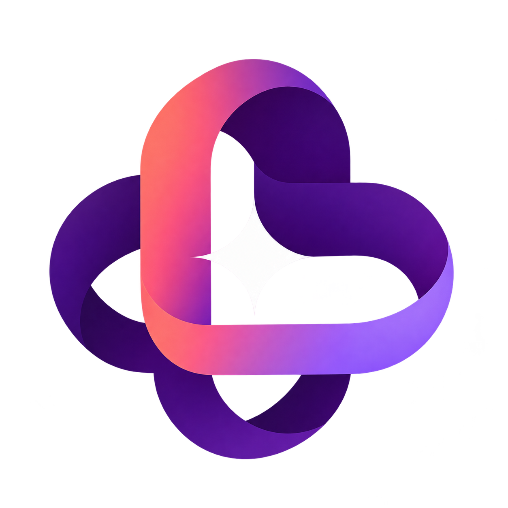
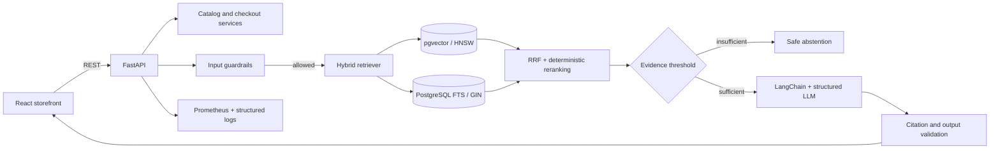

<p align="center">
  
</p>

# Lumina Commerce

Lumina is a multilingual commerce platform built around **Lumi**, an AI product expert/chatbot that combines hybrid retrieval, validated citations and deterministic commerce workflows. The storefront is English-first and supports Brazilian Portuguese and Latin American Spanish.

**Production:** [lumina-smart-store.vercel.app](https://lumina-smart-store.vercel.app)


## Company documentation

- [Product and service guide](output/pdf/lumina-product-and-service-guide.pdf)
- [Technical documentation](output/pdf/lumina-technical-documentation.pdf)
- [Lumina brand mark](frontend/public/assets/brand/lumina-logo.png)

## Product capabilities

- Responsive storefront with search, category navigation, product details and editorial collections.
- Persistent cart, inventory checks, shipping thresholds and a three-stage checkout flow.
- English-first interface with runtime switching to `pt-BR` and `es-419`.
- Lumi maintains cart context, classifies intent, compares products, recommends next steps and exposes supporting sources.
- Provider-selectable LangChain pipeline using Groq or OpenAI, with a credential-free local knowledge fallback for provider outages.
- Versioned operational knowledge covering products, shipping, returns, warranty, payments and privacy.
- Prometheus metrics, structured logs, health checks, request IDs, rate limiting and RAGAS evaluation.

## Architecture



See [docs/architecture.md](docs/architecture.md) for retrieval, scaling and threat-model details.

## RAG safety model

No generative system can guarantee the complete elimination of hallucinations or prompt injection. Lumina reduces risk through independent controls:

1. Unicode normalization, size limits and inspection for direct injection, role tags, invisible characters and encoded payloads.
2. Ingestion-time quarantine for documents that contain indirect-injection indicators.
3. Hybrid retrieval combining HNSW cosine search and Portuguese/English full-text search.
4. Reciprocal Rank Fusion to combine rankings without comparing incompatible score scales.
5. Deterministic reranking and a minimum evidence threshold before generation.
6. Explicit source boundaries that treat retrieved content as data, never as instructions.
7. Low generation temperature and Pydantic/JSON Schema output validation.
8. Citation allowlisting: source IDs not returned by retrieval are discarded.
9. No transactional tools inside the model boundary. Cart, inventory, totals and checkout remain deterministic.
10. RAGAS evaluation for faithfulness, answer relevance and context precision.

## Running the platform

### Docker Compose

```bash
cp .env.example .env
docker compose up --build
```

- Storefront: `http://localhost:5173`
- OpenAPI: `http://localhost:8000/docs`
- Health: `http://localhost:8000/health`
- Metrics: `http://localhost:8000/metrics`

Without a provider key, Lumi automatically uses the versioned local knowledge layer. For zero-cost development, create a Groq key, keep `LLM_PROVIDER=groq`, set `GROQ_API_KEY`, and ingest the knowledge base:

```bash
docker compose exec api python -m backend.app.rag.ingest
```

### Local development

Requirements: Python 3.12–3.14, `uv`, Node.js 20+ and PostgreSQL with pgvector.

```bash
uv sync --extra dev
cd frontend && npm install
```

Run the API and storefront in separate terminals:

```bash
uv run uvicorn backend.app.main:app --reload --port 8000
cd frontend && npm run dev
```

## Quality gates

```bash
uv run pytest
uv run ruff check backend
cd frontend && npm run build
uv run --extra eval python -m backend.evals.run_ragas
```

The evaluation set lives at `backend/evals/golden_dataset.json`. Production releases should add anonymized real-world questions, adversarial prompts, unanswerable queries and language-specific test cases.

## Deployment

The repository is configured as a single Vercel project. Vercel builds the Vite storefront, loads the FastAPI entrypoint from `backend.app.main:app`, and serves both from the same origin. The React build is mounted after the API routes, so `/api/v1/*`, `/health` and `/metrics` remain handled by FastAPI.

The GitHub repository is connected to Vercel. Every push to `main` creates a production deployment, while pull requests receive preview deployments. GitHub Actions runs backend linting, tests and the production frontend build before changes are merged.

Configure `APP_ENV=production`, `APP_SECRET_KEY`, `DATABASE_URL` and either `GROQ_API_KEY` or `OPENAI_API_KEY` in Vercel Project Settings. `DATABASE_URL_UNPOOLED`, when supplied by Neon, is preferred automatically. The default `EMBEDDING_PROVIDER=local` creates deterministic 1,536-dimensional vectors without an external embedding bill; `EMBEDDING_PROVIDER=openai` remains available for higher semantic recall. Run the knowledge ingestion command against the production database before enabling live vector retrieval.

### AI provider configuration

```dotenv
# Free, rate-limited Groq inference
LLM_PROVIDER=groq
GROQ_API_KEY=your-server-side-key
LLM_MODEL=openai/gpt-oss-120b

# Or paid OpenAI inference
# LLM_PROVIDER=openai
# OPENAI_API_KEY=your-server-side-key
# LLM_MODEL=gpt-4.1-mini

# Free pgvector-compatible embeddings generated inside the application
EMBEDDING_PROVIDER=local
EMBEDDING_DIMENSIONS=1536
```

Provider errors and quota exhaustion always degrade to the controlled local response path. Keys are read only by FastAPI and are never included in the browser bundle.

### Production PostgreSQL and pgvector

The recommended Vercel setup is the Neon Free plan in the São Paulo region. The Vercel Marketplace injects `DATABASE_URL` and `DATABASE_URL_UNPOOLED`; the application normalizes either standard PostgreSQL URL for SQLAlchemy/asyncpg.

```bash
npx vercel integration add neon --name lumina-postgres --billing-plan free_v3 --meta region=gru1 --meta auth=false --environment production
npx vercel env run -e production -- uv run python -m backend.app.rag.ingest
npx vercel --prod --yes
```

## Production integrations

- Connect `OrderService` to a tokenized payment provider and idempotent webhook consumer.
- Use Redis for distributed rate limiting, semantic caching and ingestion locks.
- Add OIDC authentication and tenant-aware partitioning for multi-brand deployments.
- Process ingestion, OCR and blue/green reindexing through a durable queue.
- Export OpenTelemetry traces and maintain dashboards for p95 latency, cost, recall and abstention rate.
- Run continuous red-team and RAGAS suites before model, prompt or retriever releases.

## Product photography

Product photography is stored locally under `frontend/public/assets` to avoid runtime hotlink dependencies. Sources are licensed for use under the [Unsplash License](https://unsplash.com/license):

- [Black wireless headphones by Jason Leung](https://unsplash.com/photos/black-wireless-headphones-on-black-surface-IX3Ce-P4i84)
- [Portable speaker by Habib Dadkhah](https://unsplash.com/photos/black-and-silver-portable-speaker-S0B-pmGjdVA)
- [Wireless charging ecosystem by Sayan Majhi](https://unsplash.com/photos/phone-watch-and-earbuds-charging-on-a-pad-NDA_20pwjwo)
- [Wireless earbuds by N1CE](https://unsplash.com/photos/redmi-wireless-earbuds-and-charging-case-on-a-magazine-Ljqzt-B7Djs)
- [Minimal wireless mouse by Fer Troulik](https://unsplash.com/photos/a-white-computer-mouse-on-a-white-background-LP3nV76f2TA)
- [Smartphone product photo by JIBIN SAMUEL](https://unsplash.com/photos/a-black-smartphone-resting-on-a-white-surface-vDmqcWC3yDI)
- [Tablet and phone workspace by Jakub Żerdzicki](https://unsplash.com/photos/a-tablet-and-a-cell-phone-sitting-on-a-table-SE3hxMBkOCs)
- [Game controller by Georgiy Lyamin](https://unsplash.com/photos/a-white-video-game-controller-on-an-orange-background-JTb7oA0IZPg)
- [Smart-home security camera by Jakub Żerdzicki](https://unsplash.com/photos/a-white-camera-sitting-on-top-of-a-white-table-rzh-4N9eLmc)
- Every image is shipped as an optimized local asset; the storefront does not depend on Unsplash at runtime.
